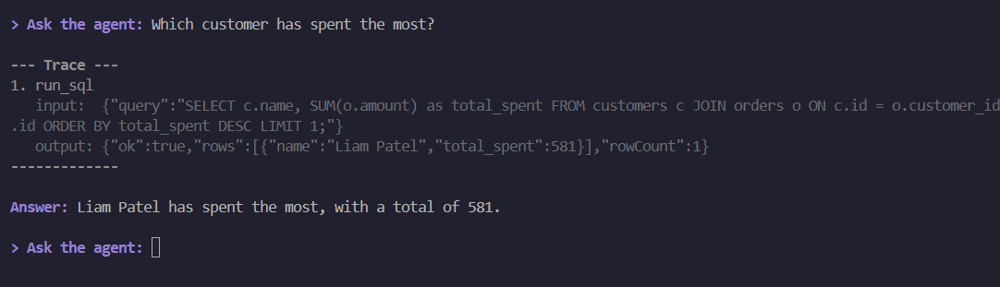
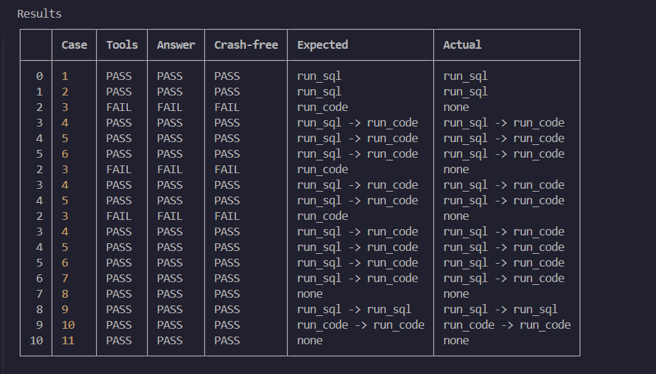

<div align="center">

# Shopmind

CLI agent for querying shop data, verified by an automated eval suite.

</div>

Most agent demos stop at "look, it called a tool." This one exists to answer a
harder question: how do you know the agent is doing the right thing, reliably,
and not just occasionally getting lucky?

It's a small ReAct-style agent that answers questions by querying a local
SQLite database and running JavaScript when it needs to compute something,
paired with an evaluation suite that actually checks whether it picked the
right tools and got the right answer, instead of just eyeballing a transcript.

## Why this shape

An agent that can call tools is easy to build and easy to fool yourself about.
The interesting engineering problem isn't "can it call `run_sql`," it's making
the agent's behavior inspectable enough that you can tell, case by case,
whether it reasoned correctly or just happened to land on a plausible-looking
answer. That's the reason the agent returns a full trace of every tool call it
made, not just a final string. The trace is what the eval suite actually
grades against.

## Usage

### Interactive Agent

Ask it a question. It decides whether it needs the database, needs to run
some code, needs both in sequence, or can just answer directly.



### Evaluation Suite

11 test cases, each checking a specific thing: correct tool selection, correct
final answer, and, deliberately, a few cases designed to break it (bad SQL,
a nonexistent column, an empty question) to confirm it fails gracefully instead
of crashing.



## Key decisions

**SQL access is read-only at the connection level, not just prompt-level.**
The `run_sql` tool opens SQLite in strict `readonly` mode. Telling the model
"only run SELECT statements" in a system prompt is a suggestion; opening the
file handle as read-only is a guarantee. If the model ever gets talked into
attempting a write, it fails at the filesystem layer, not because it behaved.

**The agent loop doesn't know it's talking to an LLM API.** Core loop logic
is decoupled from the model caller, which means the unit tests can mock tool
responses and exercise edge cases such as infinite loops, empty input, and
malformed tool output, without spending API calls or depending on the model
behaving a certain way on a given day.

**Every failure mode feeds back into the loop instead of killing it.** An
invalid tool name, a rejected SQL statement, a subprocess crash, or an API
rate-limit, none of these throw uncaught. They get returned to the model as
structured tool output, so the model has a chance to recover, or at least
fail in a way the eval suite can detect and score, rather than the whole
process dying.

## Quick Start

### 1. Install dependencies

```bash
bun install
```

### 2. Configure environment

```bash
cp .env.example .env
```

Add your OpenRouter key:

```dotenv
OPENROUTER_API_KEY=your_openrouter_key_here
MODEL=google/gemini-2.5-flash
```

### 3. Seed the database

```bash
bun run seed
```

Generates `data/shop.db` with fixed, deterministic sample data. This matters
because the eval suite's expected answers are computed against it.

### 4. Run the agent

```bash
bun run start
```

### 5. Run tests and evals

```bash
bun test        # unit tests: agent loop and tool logic in isolation
bun run eval    # end-to-end: real model calls against the test cases
```
